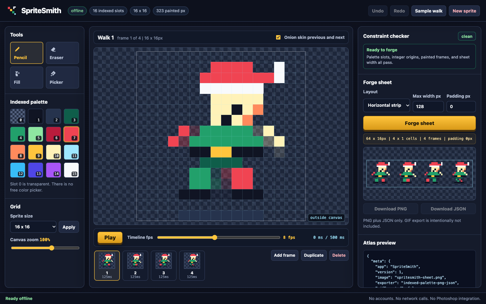
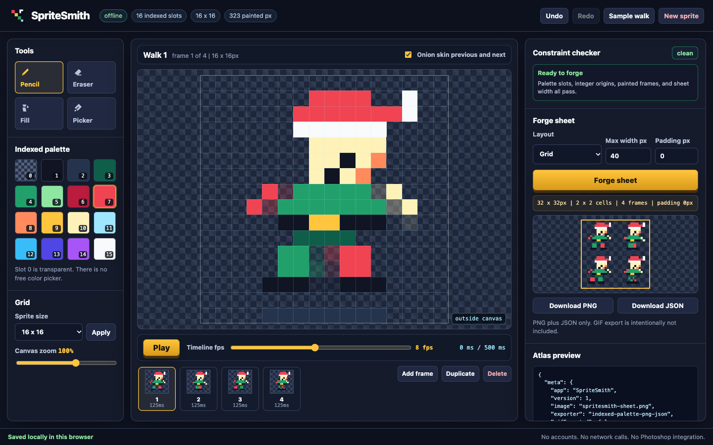
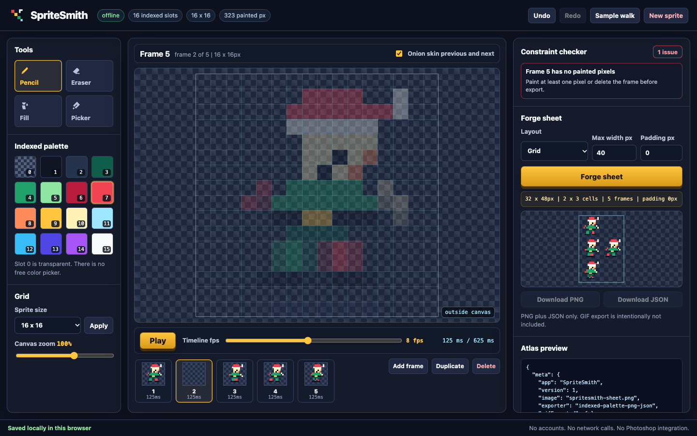

# SpriteSmith

SpriteSmith is an offline pixel-art sprite animator and sheet forge built as a single static browser app. It draws on constrained 8 x 8, 16 x 16, or 32 x 32 grids, uses a fixed 16-slot indexed palette, previews frame animation with onion skin, checks constraint violations, and exports an exact sprite sheet PNG plus a JSON atlas.

Built November 2026.

## Run it

No install step, dependencies, accounts, keys, network service, or build step are needed.

```bash
open index.html
```

Or serve it locally with Node 22 or newer.

```bash
node scripts/serve.mjs 4173
# then open http://127.0.0.1:4173/
```

The app opens with a bundled four-frame walk cycle so the timeline, onion skin, frame duplication, sheet packing, and atlas export can be tried immediately.

## Test it

Requires Node 22 or newer.

```bash
npm test
npm run test:browser
```

The unit suite has 37 deterministic `node:test` cases with 205 assertion statements. The browser harness adds 21 browser-level checks driven over CDP with real pointer clicks. Coverage includes palette validation, constrained grid sizes, frame pixel math, flood fill behavior, timeline boundary math, undo and redo, malformed project input, horizontal and grid sheet packing, atlas shape, PNG byte length, PNG chunk order, CRC correctness with an independent bit implementation, zlib round trips, constraint violation messages, frame duplication, playback, forge state, and console hygiene.

## The fixed indexed palette

The editor has no free color picker. Every pixel is one of these 16 palette slots. Slot 0 is transparent.

| Slot | Name | Hex | Alpha |
| ---: | --- | --- | ---: |
| 0 | Transparent | `#000000` | 0 |
| 1 | Ink | `#101423` | 255 |
| 2 | Midnight | `#26334D` | 255 |
| 3 | Pine | `#0F5E4A` | 255 |
| 4 | Holly | `#22A06B` | 255 |
| 5 | Mint | `#8EE6A1` | 255 |
| 6 | Cranberry | `#B91C3C` | 255 |
| 7 | Ribbon | `#F04452` | 255 |
| 8 | Coral | `#FF8A5C` | 255 |
| 9 | Amber | `#FFC53D` | 255 |
| 10 | Cream | `#FFF2B8` | 255 |
| 11 | Frost | `#9EE7FF` | 255 |
| 12 | Ice | `#38BDF8` | 255 |
| 13 | Indigo | `#4F46E5` | 255 |
| 14 | Violet | `#A855F7` | 255 |
| 15 | Snow | `#F8FAFC` | 255 |

The exported PNG is a real indexed-color PNG using color type 3, bit depth 8, a 16-entry PLTE chunk, and a 16-entry tRNS chunk. The encoder is implemented in this repository and tested byte by byte. It uses uncompressed deflate blocks inside a valid zlib stream, which favors deterministic simplicity over small file size.

## Editor features

- 8 x 8, 16 x 16, or 32 x 32 pixel grids
- fixed indexed palette with slot numbers
- pencil, eraser, flood fill, and picker tools
- onion skin for previous and next frames
- frame add, duplicate, delete, and thumbnail timeline
- playback from 1 to 16 frames per second
- undo and redo stack
- local browser save only, with export for durable files
- live constraint checker with fix hints

## Constraint checks

The checker reports four kinds of problems.

1. Palette violations: a pixel index outside slots 0 to 15.
2. Off-grid subpixels: fractional frame origin metadata such as `offsetX = 0.5`.
3. Empty frames: frames with zero painted pixels.
4. Sheet overflow: packed sheet width greater than the chosen maximum width.

Each violation includes a recovery hint. Normal editing cannot create an invalid palette index or fractional origin because the editor writes only integer indexed pixels. Those validators still run because project data can be malformed after storage corruption, future import support, or direct manipulation of the frame model.

## Sheet packing math

Horizontal layout with `n` frames, frame width `w`, frame height `h`, and padding `p` uses:

```text
sheet width  = n*w + (n-1)*p
sheet height = h
columns      = n
rows         = 1
```

Grid layout chooses columns before computing dimensions.

```text
with max width W:
columns = max(1, floor((W+p)/(w+p)))

without max width:
columns = ceil(sqrt(n))

rows         = ceil(n/columns)
sheet width  = columns*w + (columns-1)*p
sheet height = rows*h + (rows-1)*p
```

All positions are integer pixels. Frame rectangles never overlap because padding is outside the frame rectangle.

## Atlas JSON format

The exported atlas is deterministic JSON with this shape.

```json
{
  "meta": {
    "app": "SpriteSmith",
    "version": 1,
    "image": "spritesmith-sheet.png",
    "exporter": "indexed-palette-png-json",
    "gifExported": false,
    "offline": true
  },
  "size": { "w": 64, "h": 16 },
  "layout": "horizontal",
  "fps": 8,
  "frameCount": 4,
  "frames": [
    {
      "name": "Walk 1",
      "frame": { "x": 0, "y": 0, "w": 16, "h": 16 },
      "duration": 125,
      "pivot": { "x": 0, "y": 0 }
    }
  ]
}
```

`frame` is the pixel rectangle inside the sheet. `duration` is milliseconds. `pivot` is integer frame-origin metadata reserved for game-engine alignment. Fractional pivot metadata is reported by the constraint checker and normalized to zero in the atlas rather than silently exported.

## Honest limits

- PNG and JSON export only. There is no GIF or APNG export.
- No Adobe Photoshop integration, Photoshop file import, or Photoshop automation.
- No free color picker, gradients, anti-aliased brushes, layers, or vector drawing.
- The bundled sample is intentionally simple and is not presented as professional game art.
- The PNG writer is deterministic and correct, but its uncompressed deflate stream is larger than compressed output from a full encoder.
- Local save uses browser storage. Export PNG and JSON for durable output.

## Project structure

```text
index.html                  static editor page
styles.css                  offline interface styling
app.js                      browser state, canvas editing, playback, export UI
src/palette.js              fixed 16-slot indexed palette
src/sprite.js               frames, constraints, timeline, history, serialization
src/pack.js                 exact horizontal and grid sheet packing plus atlas generation
src/png.js                  deterministic indexed PNG encoder
src/sample.js               bundled four-frame walk cycle
tests/                      node:test unit suites
scripts/serve.mjs           tiny local static server
scripts/checks.mjs          browser-level CDP assertion pass
scripts/screenshots.mjs     three-image 1440x900 headless-Chrome capture
assets/                     real generated screenshots
video/                      narration, capture steps, and demo video artifacts
```

## Screenshots







## AI-assistance disclosure

AI coding assistants were used during implementation, debugging, test design, documentation, and video-production scripting. The pixel format, sheet math, PNG bytes, tests, screenshots, and final claims were checked with deterministic automated tests and real browser captures. Local voice synthesis was used for narration in the demo video.

## License

MIT. See [LICENSE](LICENSE).
